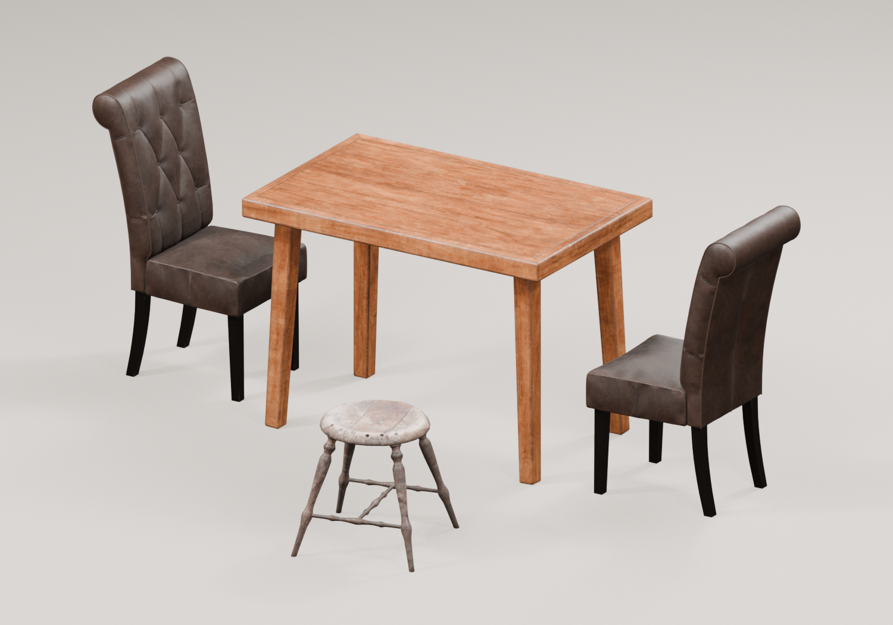

# Editable dining showcase / 可编辑餐厅展示

[Open the Blender file / 打开场景](dining-showcase.blend) · [Placement manifest / 摆放清单](placement.json) · [Asset sources / 资产来源](asset-sources.json) · [Verification / 核验](verification.json)



The builder reads a frozen [synthetic dining scene](../dining-complete/README.md) and places finished Poly Haven furniture at its four recorded object identities. The table, west chair, east chair and stool have independent editable roots and local mesh data. The `.blend` embeds its textures and includes a studio camera, lights and ground. The original fitted furniture and observations remain available in the file’s comparison collections.

这个示例以项目的合成餐厅为布局底稿。家具外形与材质来自成品资产，项目按固定映射完成摆放、来源记录、原生编辑和保存回读。真实茶室的误差证据见 [Table0 报告](../../reports/TABLE0-ERROR-2026-10-15.zh-CN.md)。

## Open and rebuild / 打开与复建

Open the native file in Blender. In the Outliner, open `Showcase furniture - editable assets` to select a root for an entire piece, or a child mesh for geometry editing. Use Material Preview to view the furniture textures.

从项目根目录执行。实测使用 Blender 5.1.2，`blender` 指向对应可执行程序。构建输出使用新的 `.blend` 文件名。

```console
blender --background --factory-startup --disable-autoexec --python-exit-code 1 --python build_dining_showcase.py -- --manifest examples/dining-showcase/placement.json --output dining-rebuilt.blend
blender --background --factory-startup --disable-autoexec --python-exit-code 1 --python build_dining_showcase.py -- --mode verify --manifest examples/dining-showcase/placement.json --output dining-rebuilt.blend
```

[Builder](../../build_dining_showcase.py) reads the source assets and applies the declared orientation, scale and floor height. [Studio setup](../../stage_dining_showcase.py) places the camera, lighting and stage. Input hashes and publisher links are in the asset manifest. Blender’s Render Image command uses the saved camera and render settings.

Furniture assets are [Wooden Table 02](https://polyhaven.com/a/wooden_table_02), [Dining Chair 02](https://polyhaven.com/a/dining_chair_02) and [Wooden Stool 01](https://polyhaven.com/a/wooden_stool_01), with [Poly Haven’s CC0 license](https://polyhaven.com/license). See [source and artifact terms](../../THIRD_PARTY_NOTICES.md) for the original scene and other experiments.
