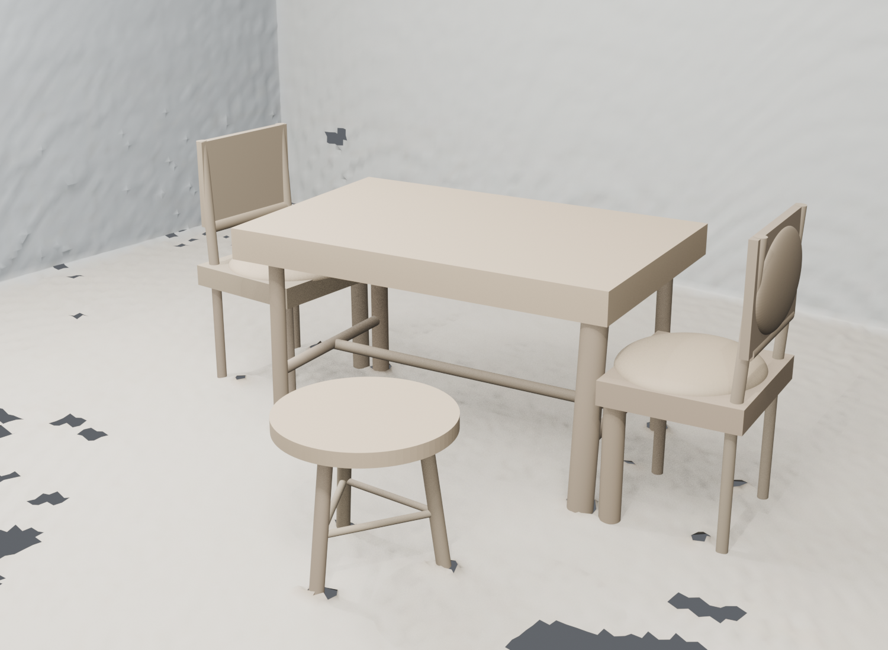
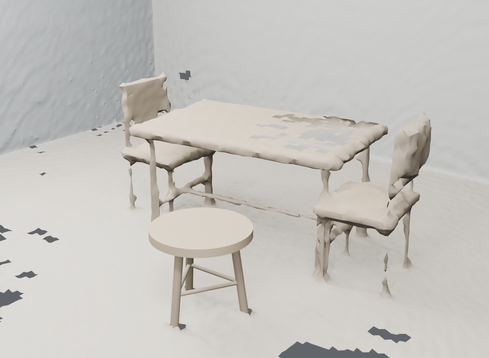
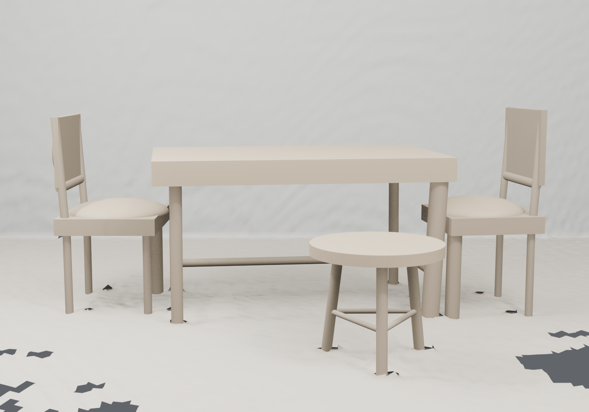
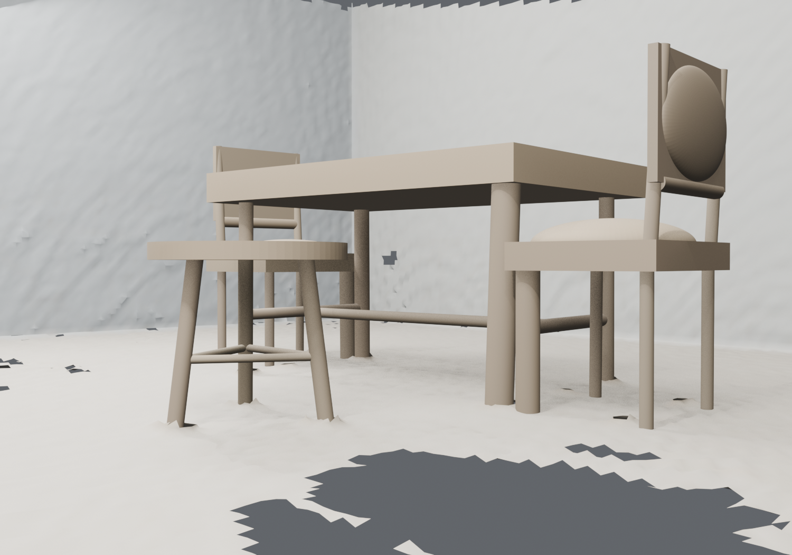

# 完整可编辑餐桌场景：形状、摆放与导出的实测结果

实测日期：2026-10-13，北京时间 · [English](DINING-COMPLETION-2026-10-13.md) ·
[打开、编辑与复现](../examples/dining-complete/README.md)

既有公开餐桌开发场景现在包含已验收的圆凳、补全后的桌子和两把椅子，具有四个
可独立选择的家具根对象、37 个可编辑部件。三个新对象通过原始观测的固定三角网格
门槛，保留来源证据，并通过原生编辑、撤销／重做、独立进程重开和 GLB 导出／导入。
用户指出椅座与桌腿相交后，最终场景又补上了独立的跨家具实体间隙验收：
**507 对部件全部通过，native／导出的最小认证间隙约为 5.549958 mm。**

“凳子好看了能说明什么”的具体回答是：已经得到一个可复现、可追踪、可编辑、
经过几何和摆放检查的工程阶段成果。外观改善提供可用性检查线索，更强的证据来自
实测误差、保留的输入、失败对照和可复现的编辑／导出过程。本案例是受控合成开发
案例，其适用范围由观测、所选家具结构和验收口径限定。桌子的参考网格反向面积
P95 仍由原始 B1 的 **17.933 mm 恶化到 48.378 mm**；观测贴合改善并不同时证明
隐藏部分和全部物理形状更准确。

## 输入、拟合与保持不变的验收门槛

输入是既有 18 视角公开合成餐桌观测包，使用
[scene.json](../examples/stool-fit/input/scene.json) 和
[observations.npz](../examples/stool-fit/input/observations.npz)。操作者明确选择矩形
桌面和矩形椅座／椅背结构，每件新家具有四根直圆支撑。几何、颜色和证据选择只
使用 0–16 的九个偶数帧、观测点与 RGB、原有候选／归属记录、竖直对象先验及
实测地面。1–17 的九个奇数帧用于开发验证。验证结果参与过方法诊断，因此这些
帧不是未触碰的最终测试集。

对象先验框相互竞争，部分可见椅子支撑被原始归属分到桌子。拟合从偶数帧目标
候选中恢复支撑证据，并对椅座曲面帽使用局部原归属偶数帧点，避免桌面观测混入。
独立评估器从原始输入重新构造候选偶数帧支持池，不直接相信拟合器的支持标志。
桌子／西椅／东椅的候选偶数帧池分别有 4,801／3,005／3,321 点，原归属偶数帧
分别为 2,808／2,008／2,325 点。训练选择不改变验证分母：三个对象的
**2,840／1,848／2,451 个原归属奇数帧点全部保留，排除数均为零。**

预先声明的形状门槛逐对象要求：实际导出三角网格 P95 ≤10 mm，且至少 95% 的
上述原始奇数帧点距离 ≤10 mm；每个部件都有实测候选偶数帧支持，参数与组装网格
相符，网格闭合、朝外绕序一致且体积为正，预定接触图连通，四只支撑脚距离实测
地面不超过 3 mm。不可见封闭面及延伸到接触处的几何明确属于结构补全。各部件
保留独立闭合壳体，关节处有意实体重叠，用于保持接触和单独编辑。

[fit_dining.py](../fit_dining.py) 保存输入、代码哈希及声明的读取范围；
[evaluate_dining.py](../evaluate_dining.py) 使用 Open3D 0.19.0 独立测量实际 PLY
三角网格。物理参考包在拟合冻结后仅用于独立评估，不是拟合输入。评估前后的
输入和候选哈希保持一致。拟合器的读取范围有可检查代码和重放支持；它不等于
操作系统级的全部上游文件访问审计。

## 失败对照与最终曲面模型

训练投影显示椅座隆起、椅背弯曲，同时存在平面的底层结构。矩形薄板对照失败，
单一穹顶薄板也未通过同一门槛。最终采用矩形椅座／椅背底层与单独闭合的凸
半椭球软垫。候选椅座曲面池受桌面污染的中间尝试仍失败，最终尝试改用局部
原归属偶数帧点拟合曲面帽。10 mm／95% 门槛和原始奇数帧验证群体均未放宽。

下表使用归档的矩形、穹顶对照与最终模型的**实际导出三角网格距离**。方法历史
中的解析残差是另一种诊断口径，不能替代这些数值。

| 曲面尝试 | 西椅 P95，mm | 西椅 ≤10 mm | 东椅 P95，mm | 东椅 ≤10 mm | 形状结论 |
|---|---:|---:|---:|---:|---|
| 矩形薄板 | 21.926 | 71.970% | 19.939 | 70.828% | 失败 |
| 单一穹顶薄板 | 12.424 | 92.154% | 12.849 | 92.697% | 失败 |
| 分离底层／软垫，最终原归属曲面选择 | 5.668 | 98.593% | 7.570 | 97.103% | 通过 |

[method-history.json](dining-completion/method-history.json) 保留五次拟合尝试和最终
冻结运行。[method-controls.zip](../examples/dining-complete/method-controls.zip)
保存历史参数、PLY 及两次观测评估，
[method-controls.json](dining-completion/method-controls.json) 记录归档哈希；历史
路径和代码哈希按原样保留，可本地解压后用明确路径重新评估网格。
[训练投影图](dining-completion/candidate-training-projections.png) 保存曲面诊断依据。
独立网格检查还覆盖导出绕序、参数对应关系、软垫截面和半径；Blender 导入实际
网格，不根据元数据重新生成形状。

## 原观测坐标下的形状与物理参考测量

原始 B1 网格与最终拟合网格都使用同一冻结观测坐标和验证群体。三个对象全部
通过声明的形状门槛。下表来自
[evaluation.json](dining-completion/evaluation.json)，距离对象为实际导出三角网格。

| 对象 | 原始奇数帧点 | B1 均值／P95，mm | B1 ≤10 mm | 最终均值／P95，mm | 最终 ≤10 mm |
|---|---:|---:|---:|---:|---:|
| 桌子 | 2,840 | 7.808／26.693 | 74.754% | 0.970／3.692 | 99.894% |
| 西侧椅子 | 1,848 | 10.441／25.213 | 56.494% | 1.863／5.668 | 98.593% |
| 东侧椅子 | 2,451 | 13.343／33.906 | 50.347% | 2.049／7.570 | 97.103% |

30 个新部件都有实际三角距离 ≤10 mm 的训练支持；桌子／西椅／东椅单个部件
最少分别为 79／47／57 点。
[Open3D 回读](dining-completion/final-open3d-readback.json) 确认全部 30 个网格
水密、可定向且体积为正。桌子有 10 个已认证预定接触，两把椅子各有 15 个；
接触图均连通，四脚均通过 3 mm 落地门槛。本合成输入的最大脚底间隙为
0.000469 mm。

独立物理参考诊断同时显示覆盖改善和剩余形状误差。有效观测射线召回包含所有
给定视角的重复射线；反向准确率对每个网格以固定种子 20261013 进行 30,000 个
均匀三角面积采样，包括部件重叠处的内部壳面。

| 对象 | 参考射线 | 射线 ≤10 mm，B1 → 最终 | 射线 P95，mm，B1 → 最终 | 反向面积 P95，mm，B1 → 最终 | 反向面积 ≤10 mm，B1 → 最终 |
|---|---:|---:|---:|---:|---:|
| 桌子 | 31,128 | 55.705% → 96.887% | 224.537 → 6.450 | **17.933 → 48.378** | **83.307% → 57.970%** |
| 西侧椅子 | 19,338 | 46.080% → 94.467% | 263.836 → 10.493 | 27.120 → 25.088 | 59.830% → 74.220% |
| 东侧椅子 | 23,292 | 41.473% → 92.972% | 260.804 → 12.204 | 35.599 → 23.502 | 54.030% → 71.883% |

这些群体与原归属奇数帧验证点不同。重复射线召回不代表完整表面或可见面积完整率，
壳面反向采样不代表暴露在外的实体并集面积；它们也不是声明的观测门槛。桌面拟合
厚度为 118.415 mm，评估专用参考厚度为 70 mm，下表面偏差为 48.378 mm；
第四根桌腿的部件反向 P95 也达到 69.268 mm。较好的已观测表面贴合与较大的
补全形状误差在这里同时存在。冻结的参考结果产生后没有据此重新拟合或改动网格。

## 用户纠正后补上的跨家具实体间隙验收

最初原生验收检查了单件家具内部的接触和导出一致性，却漏掉不同家具之间的实体
碰撞。用户指出椅座穿入桌腿。随后独立诊断冻结的实际三角网格，发现
**10 对正体积相交部件**，另有一对认证间隙仅 **3.153 mm**。已验收圆凳没有碰撞。
先前 native 图像和通过记录作为本地历史证据保留，最终完整场景使用修正后的产物。

[evaluate_dining_layout.py](../evaluate_dining_layout.py) 检查 37 个实际闭合凸部件，
以共同内部见证点识别实体交集，并用最近单纯形凸距离处理交叉实体。最终验收采用
实际顶点约束的分离平面：第一部件每个顶点位于平面一侧，第二部件每个顶点位于
另一侧，两组沿单位法线的投影间隔满足门槛，因而其三角形及封闭内部也被分离。
全部 507 对跨家具部件都有证书，检查对象是实际网格。
[layout.json](dining-completion/layout.json) 保留原始碰撞、最终证书、冻结输入及
规范化变换哈希。

最终摆放只增加明确记录的水平根对象平移，桌子和圆凳固定。沿每把椅子的既有
向外轴进行有界搜索，以 5.5 mm 认证目标加摆放精度余量选择位移；这只是当前
方向和固定其他家具条件下的搜索。

| 根对象 | 世界 Y-up 米制平移 [X, Y, Z] |
|---|---|
| 桌子 | [0, 0, 0] |
| 西侧椅子 | [−0.1118755615, 0, 约 0] |
| 东侧椅子 | [+0.1049262697, 0, −0.0147464255] |
| 已验收圆凳 | [0, 0, 0] |

前面的拟合／观测／参考指标保持原观测坐标，**不是平移后最终展示布局的误差指标**。
所有 PLY 字节和原始观测对象变换保持原坐标，摆放平移单独记录。独立最小认证
间隙为 5.550033615 mm。Blender 在保存前、独立进程重开后、编辑撤销恢复后和
GLB 导入后，都用实际世界顶点重新检查同一组证书：native／撤销后最小值为
**5.549958020 mm**，GLB 为 **5.549958393 mm**，均超过所需 5 mm。原生记录
将公开布局 JSON、规范化平移、拟合及圆凳输入的准确字节绑定在一起。

## 原生可编辑交付与证据保留

[complete-dining.blend](../examples/dining-complete/native/complete-dining.blend)
是原生编辑依据；[complete-dining.glb](../examples/dining-complete/native/complete-dining.glb)
导出可见几何、层级和元数据。四个独立可选根对象名为
`Fitted Stool (structural completion)`、`Completed Table`、
`Completed Chair West`、`Completed Chair East`。

| 家具 | 可编辑部件 | 三角形 |
|---|---:|---:|
| 原有已验收圆凳 | 7 | 2,240 |
| 完成后的桌子 | 8 | 2,252 |
| 完成后的西椅 | 11 | 14,552 |
| 完成后的东椅 | 11 | 14,552 |
| 家具合计 | 37 | 33,596 |

桌子包含桌面、四腿和三根连接杆；每把椅子包含椅座底层、四腿、椅座软垫、椅背
底层、椅背软垫、两根背柱和一根背杆。根对象 Transform 用于整体移动／旋转／
缩放；子网格 Transform／Dimensions 和原生 Edit Mode 用于部件编辑。参数和
来源哈希描述已验收拟合状态，不会自动重新生成网格。

**17 个原有对象**的几何、变换、属性、材质和自定义属性全部保持一致。原观测
桌椅及 `Unresolved (-2)` 只改变所属集合和可见性，保留在可切换的
`Original dining observations + ambiguous fragments (hidden)` 对照层。
含糊对象保留 `unresolved` 身份、1,996 个顶点、3,605 个三角形和记录的边界，
在 before 渲染中可见，明确归类为含糊观测餐桌碎片。原始环境仍可见，已验收
圆凳保持不变；原始观测圆凳有自己的对照集合。

三个新根对象均实际测试了 Blender 坐标平移 [0.15, 0.10, 0] m、Z 轴旋转 17°、
X 尺寸放大为 1.05 倍，子部件一致移动，无关网格不变。撤销、重做、再次撤销
恢复最终 authored layout 和全部保留来源。Blender 5.1.2 独立进程重开保存文件；
10 个保存的三维视口关闭辅助线覆盖。可见 GLB 共有 **38 个网格**，包括原环境。

| 一致性检查 | 最大误差 |
|---|---:|
| 新部件 native 顶点对冻结 PLY 加摆放平移；面索引完全一致 | 0.230463 µm |
| 根对象仿射编辑对预期子部件几何 | 0.186002 µm |
| GLB 往返有向三角形角点对应 | 1.177270 µm |

原生记录还逐一将圆凳七部件与原始 PLY 几何比较。GLB 验收覆盖可见对象清单、
根／部件层级、PLY 来源和原环境外观；任意 Blender 面级来源属性仍以原生文件
为准。[scene-integration.json](../examples/dining-complete/native/scene-integration.json)
记录这些实际结果及重复执行的跨家具间隙门槛。

下图均为实际 Blender 渲染。历史和最终运行的相机不变，before／complete 使用
同一相机和灯光；before 显示保留观测碎片及已验收圆凳。布局纠正后的四张图
均完成了实际视觉检查。
最终元数据链重放的四张图与已检查图像的解码 RGBA 像素完全一致；PNG 字节因
Date／RenderTime 元数据变化而不同。

## 复现、守卫与验证范围

实测主机为 Windows x64。拟合环境使用 CPython 3.13.5、NumPy 2.1.3 和
SciPy 1.15.3（[requirements-fit.txt](../requirements-fit.txt)）；独立几何环境
使用 CPython 3.12.14、NumPy 2.3.5 和 Open3D 0.19.0
（[requirements-local.txt](../requirements-local.txt)）。原生验收和实际图像渲染
使用 Blender 5.1.2。它们是既有的独立环境，各自准备对应可选依赖。

[双语操作说明](../examples/dining-complete/README.md) 提供既有 Windows 解释器、
依赖和拟合 → 形状评估 → 布局评估 → 原生构建 → 独立进程重开的命令。输出使用
新目录；导入器拒绝过期评估、非水平平移、输入变化、不安全 PLY 路径、证书遗漏
和会覆盖输入的目标。实现复用一次 Y-up → Blender Z-up 旋转，无需新增拟合界面。

[独立拟合重放](dining-completion/independent-fit-replay.json) 逐字节重现全部
**33 个部件／组装 PLY 文件**；
[形状评估器验证](dining-completion/evaluator-verification.json) 记录逐字节一致的
参考重提取。最终 [Open3D 环境全套测试](dining-completion/final-tests.log) 为
**240 项、零失败／错误、跳过 4 项**，跳过原因是该环境缺少可选 SciPy 拟合依赖；
其中 **22 项形状、12 项布局、18 项 native 输入／分离测试全部通过**。
最终 [conda 拟合环境测试](dining-completion/final-fit-environment-tests.log) 同样运行
240 项，零失败／错误，因缺少 Open3D 跳过 106 项，11 项餐桌拟合测试全部通过。
这两个既有环境提供互补覆盖。此前布局加入前的 conda 运行是 218 项、跳过
92 项，保留为历史部分覆盖。

最终复核补上了读取前绑定观测哈希、读取后及拟合后再次核对输入变化的控制，
输入改变时拒绝结果；两个独立评估 CLI 在门槛失败时返回失败退出码。随后重新
生成最终拟合／形状评估／布局元数据链，并重新构建和重开 native。全部 33 个
PLY 文件、形状结果、布局平移和 507 份证书保持一致；改动加强的是验收执行与
输入绑定，家具几何没有改变。

本机有守卫的拟合重放用时 1.736 s，最终原生构建 7.150 s，独立重开 17.814 s。
这些是单次实际执行记录，不是吞吐性能基准。守卫记录的 Python 运行时网络尝试
均为零，DNS 拒绝探针通过。最终布局守卫还拒绝读取两处物理参考根目录，实际
尝试数为零。对应记录为
[拟合守卫](dining-completion/independent-fit-guard.json)、
[布局守卫](dining-completion/final-layout-guard.json)、
[构建守卫](dining-completion/native-delivery-build-guard.json) 和
[重开守卫](dining-completion/native-delivery-reopen-guard.json)。
这些检查覆盖各记录声明的 Python socket／DNS／文件访问范围，不代表原生库或
子进程的操作系统级隔离。

| 最终冻结产物 | SHA256 |
|---|---|
| 拟合 JSON | `1cb164fbe6272e48ca41507fd71e037aa70956131630d589e039c56d16c099a1` |
| 独立布局 JSON | `0ddbf52fa39f65014bb199e819f3cc63a60adc1f06cf726fcfc6f94060685345` |
| 已验收来源 Blender 场景 | `27144f490ac987a6445acc46ef7ec1ceb1c89b87c8f057a057ede3f650617e2b` |
| 最终 Blender 场景 | `4dba3e5be30ed597d1fd5ca6e36449106e3eab9f1d3e8873e4437ace0ca507da` |
| 最终 GLB | `768a4c69b5fdc9e110be8b4031928aa7bd3d6a55615eb3b1a9c3cd13133dbbd2` |

这次完成的能力已有可检查证据：观测支持、明确形状门槛、含糊来源保留、经过
碰撞检查的可用摆放、原生编辑及可靠格式交换。真实扫描补全、独立留出家具和
实际人工纠正时间仍需各自的证据。[已有真实桌面报告](REAL-TABLETOP-2026-10-09.zh-CN.md)
继续保留跨视角失败结果，
本次合成场景补全没有解决那项问题。
